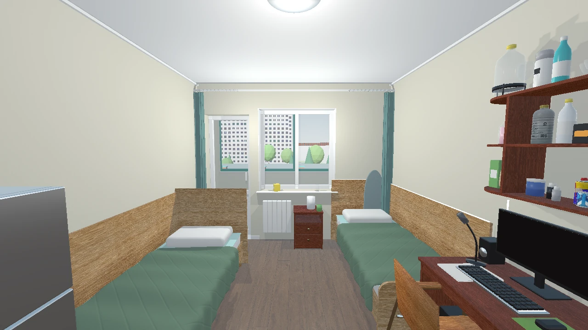
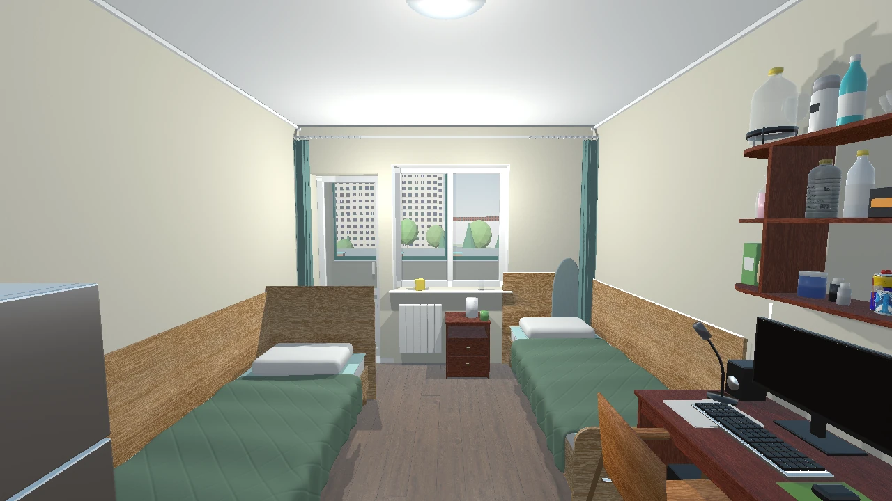

# Визуальная проверка «Общаги»

**Примечание после объединения (16.11.2026).** Приведённые ниже
контрольные WebP были сняты до переноса исправлений оконного блока
из `codex/dorm-night-light`. Они полезны как историческая база,
но для визуальной приёмки нового света нужны свежие кадры на текущей
GLB. Обычный дневной режим оставлен по умолчанию, оба прототипа опциональны.

Исходное состояние снято с `acf5ab8` в Godot 4.7.2, OpenGL Compatibility на Mesa llvmpipe (Linux, программная графика). Все кадры 1280×720, FOV 72°. Камеры и тональное отображение совпадают в дневной паре. Кадры в галерее сжаты в WebP; Godot сохраняет PNG.

| Режим | 1 · Из комнаты к окну | 2 · От кровати на стол и шкаф | 3 · Из лоджии на улицу | 4 · У двери, вниз к порогу |
|---|---|---|---|---|
| День | [1](Кадры/before-0-1.webp) | [2](Кадры/before-0-2.webp) | [3](Кадры/before-0-3.webp) | [4](Кадры/before-0-4.webp) |
| Вечер | [1](Кадры/before-1-1.webp) | [2](Кадры/before-1-2.webp) | [3](Кадры/before-1-3.webp) | [4](Кадры/before-1-4.webp) |
| Ночник | [1](Кадры/before-2-1.webp) | [2](Кадры/before-2-2.webp) | [3](Кадры/before-2-3.webp) | [4](Кадры/before-2-4.webp) |

## Один дневной кадр

| Исходный Compatibility | Экспериментальный свет Compatibility |
|---|---|
|  |  |

Флаг `--daylight-prototype` усиливает два источника у окна и уменьшает дневные ambient и заполняющий свет в центре комнаты. Лучше видны рельеф покрывал, тень изголовья и граница света на полу. У окна и на части потолка остаются яркие пятна, тени от мелочей на полке жёсткие. Для пробного варианта оставлен явный флаг, вечерний и ночной свет с ним используют исходные значения.

Forward+ запрошен на том же дневном ракурсе. Vulkan не предоставил `VK_KHR_surface`, движок переключился на OpenGL Compatibility. Кадр после переключения нельзя использовать для сравнения. FPS на целевом ПК и рендер на GPU ещё не измерены. По умолчанию проект запускается в Compatibility.

## Десять визуальных проблем

P0 — первая очередь для светового прототипа, P1 — следующий визуальный этап, P2 — после основных поверхностей. Номера Fxx относятся к [карте кадров](../Фото_референсы/Карта_кадров.md).

| № | Приоритет | Наблюдение | Фиксированный ракурс и опора |
|---|---|---|---|
| 1 | P0 | Дневное заполнение выравнивает стены и мебель, контактные тени слабы. | День 1–2, дневной стол из [разбора фото](../Фото_референсы/Референсы_14-11.md). |
| 2 | P0 | Блики у окна и на потолке съедают границы белых поверхностей. | День 1, фото балконной двери подтверждает глубину откосов, экспозиция телефона условна. |
| 3 | P1 | Вечерний свет почти одинаково окрашивает дальние стены и дерево. | Вечер 1–2. Нужен кадр с одним включённым потолочным светом. |
| 4 | P1 | Ночной свет тумбочки краснее референса, на полу почти без отражённого пятна. | Ночь 1, [фото ночника](../Фото_референсы/04-ночник.jpg), F13. |
| 5 | P1 | Контрастный древесный рисунок стеновой отделки и щитов перетягивает внимание. | День 1–2, F09–F10 и фото кровати из разбора. |
| 6 | P1 | Покрывала читаются как равномерная сетка стёжки, складок у кромок мало. | День 1–2, зелёное покрывало из разбора фото. |
| 7 | P1 | Ламинат выглядит сероватым, длинный рисунок досок теряется. | День 1 и 4, F05 и дневной кадр кровати из разбора. |
| 8 | P1 | На рабочем месте тонкие кромки полки и стола выглядят резкими. | День 2, дневной ракурс стола из разбора, F15 для взаимного положения. |
| 9 | P2 | Стекло лоджии почти не меняет вид фона, рамы и направляющие выглядят схематично. | День 3, [фото лоджии](../Фото_референсы/02-лоджия.jpg). |
| 10 | P2 | Фасады и кроны геометрически простые, отличия рам и обрамлений теряются. | День 3, F18–F21 из индекса, без выводов о точных размерах. |

Сверены схема проекта, четыре сжатых фото в Git и описания кадров. Оригиналы из папки «Общага» через подключённый Google Диск не нашлись. Ссылки Fxx указывают на будущую сверку с видео. Нужны дневной кадр торца у окна, кадр с потолочным светом и уточнение оценочных размеров только там, где от них зависит геометрия.

## Воспроизведение

Из каталога проекта, Godot 4.7.2. Для снимков нужен графический дисплей. `godot` можно заменить полным путём к бинарнику.

```bash
godot --headless --editor --path . --import

for check in ходьбы маршрута комнаты поз взаимодействий сохранения; do
  godot --headless --path . --script "Инструменты/проверка_${check}.gd" || break
done
godot --path . --script Инструменты/проверка_ходьбы.gd

mkdir -p shots
for light in 0 1 2; do
  for view in 1 2 3 4; do
    godot --path . -- --view="$view" --light="$light" --shot="shots/before-$light-$view.png" --frames=6
  done
done
godot --path . -- --view=1 --light=0 --shot=shots/compatibility-day-1.png --frames=6 --daylight-prototype
godot --path . --rendering-method forward_plus --rendering-driver vulkan -- --view=1 --light=0 --shot=shots/forward-day-1.png --frames=6
```

Для замера на целевом ПК запустить ту же сцену с `--print-fps --disable-vsync` отдельно с каждым рендерером. Проверить строку драйвера в журнале, измерить один и тот же маршрут с одинаковыми разрешением и настройками. После получения настоящего кадра Forward+ сравнить стекло, тени и время кадра, затем выбирать рендерер.

## Второй прототип дневного света (16.11.2026, не принят)

В `scripts/dorm.gd` добавлен флаг `--daylight-prototype-v2`.
Он оставляет сниженную дневную фоновую освещённость от первой пробы,
но меняет два круглых источника у окна на широкие направленные `SpotLight3D`.
Они смотрят внутрь комнаты, работают как **приближение переотражённого
света**, не дают собственных жёстких теней и зеркальных бликов.
Солнечные тени при этом не отключаются. Центральное дневное заполнение
в v2 равно 0,12 (в v1 — 0,09, в обычном варианте — 0,22).
Это попытка снять пересветы возле окна и потолка, не возвращаясь к
равномерно светлым стенам. **Качество v2 по новым снимкам пока не проверено**:
в текущей сессии отсутствует исполняемый Godot 4.7.2 и графический дисплей.
По умолчанию остаётся прежний свет, v1 и вечер/ночь не изменены.

Запустить из каталога `Игры/Общага` и сравнивать одни и те же позиции камеры,
FOV, разрешение и тональное отображение:

```sh
godot --headless --editor --path . --import
godot --headless --path . --script Инструменты/проверка_света.gd
godot --headless --path . --script Инструменты/проверка_света.gd -- --daylight-prototype
godot --headless --path . --script Инструменты/проверка_света.gd -- --daylight-prototype-v2

godot --path . -- --view=1 --light=0 --shot=shots/day-original-1.png --frames=6
godot --path . -- --view=1 --light=0 --shot=shots/day-v1-1.png --frames=6 --daylight-prototype
godot --path . -- --view=1 --light=0 --shot=shots/day-v2-1.png --frames=6 --daylight-prototype-v2
godot --path . -- --view=2 --light=0 --shot=shots/day-v2-2.png --frames=6 --daylight-prototype-v2
```

Проверить на снимках: читается ли откос и граница потолка, не исчезли ли
контактные тени мебели и стёжка покрывал, нет ли новых резких пятен на
стенах или излишней темноты у шкафа. Сверить оба дневных ракурса, затем
пройти вечер и ночь. Если результат v2 лучше на целевом GPU, можно
рассмотреть его для режима по умолчанию; без сравнения этого не делать.
`Инструменты/проверка_света.gd` проверяет структуру источников и
переключение режимов, **но не заменяет визуальную приёмку**.

## Проверки

| Проверка | Исходное состояние |
|---|---|
| Импорт Godot | Пройден |
| Ходьба | Пройдена с дисплеем, включая ввод и прыжок |
| Маршрут | Пройден, от входной площадки до лоджии и обратно |
| Комната | Пройдена, свет, шторы и восстановление |
| Позы | Пройдены, приседание, 2 стула, 2 кровати, вставание |
| Взаимодействия | Пройдены, 18 узлов, препятствия, луч и защита игрока |
| Сохранение | Пройдено, игрок, камера, 18 состояний, отсутствующий и неполный файл |

С флагом прототипа импорт и все шесть проверок в headless пройдены. При параллельном прогоне тест комнаты один раз попал лучом в подвижный объект вместо выключателя; отдельный повтор прошёл. Ввод и прыжок с дисплеем проверены на исходном свете. Blender-переэкспорт для этого этапа не потребовался.

## Сверка с фотографиями от 23.11.2026

[Разбор 12 фотографий с игровыми кадрами и комментариями](../Документы/Фотосверка_2026-11-23/Сводка_фотосверки_2026-11-23.md).

## Контрольные кадры после установки моделей

Godot 4.7.2, Compatibility, 800×600. Санузел снят с одной камеры до и после установки v2. Кадр «до» воспроизведён из состояния от 23.11 до подключения санузла v2.

- Санузел [до](Кадры/Проверка_интеграции_2026-11-23/санузел-база-4x3.png), [после](Кадры/Проверка_интеграции_2026-11-23/санузел-после-4x3.png) и [стык порога](Кадры/Проверка_интеграции_2026-11-23/санузел-порог.png).
- [Куртки и обувь в прихожей](Кадры/Проверка_интеграции_2026-11-23/прихожая-предметы.png).
- БЦ «Асгард» с лоджии [днём](Кадры/Проверка_интеграции_2026-11-23/асгард-день.png) и [вечером](Кадры/Проверка_интеграции_2026-11-23/асгард-вечер.png).

## Левая створка лоджии и второй стол

- [Створка открыта](Кадры/створка-открыта.png). Внутренняя створка сдвинута вправо, проём слева открыт.
- [Второй стол](Кадры/второй-стол-белый.png). Белая столешница в дневном режиме Godot.

## После исправлений по фотосверке

- [Комната и обе розетки](Кадры/После_фотосверки/комната-после.webp)
- [Подоконник, радиатор, тумбочка](Кадры/После_фотосверки/тумбочка-и-окно-после.webp)
- [Санузел с порога](Кадры/После_фотосверки/санузел-с-порога-после.webp)
- [Душ и отделка](Кадры/После_фотосверки/душ-после.webp)
- [Второй стол](Кадры/После_фотосверки/второй-стол-после.webp)
- [Двор и облицовка справа](Кадры/После_фотосверки/двор-после.webp)
- [Ночной режим](Кадры/После_фотосверки/ночная-комната-после.webp)
- [Лоджия](Кадры/После_фотосверки/лоджия-после.webp)
- [Штукатурка у двери](Кадры/После_фотосверки/фактура-стены-после.webp)
