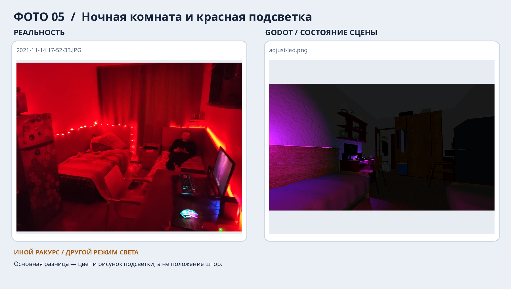

# Фото 05 — Ночная комната и красная подсветка

**Источник:** `обшага.rar` → `обшага/2021-11-14 17-52-33.JPG`. **Проверено:** 23.11.2026.
**Игровой кадр:** `shots/adjust-led.png` — ранее сохранённый кадр Godot. иной ракурс / другой режим света.
**Сравнение:** [`05-ночная-комната-фото-и-godot.png`](../../Графика/Кадры/Фотосверка_2026-11-23/05-ночная-комната-фото-и-godot.png).
**Приватность:** на исходном фото есть люди. Сравнение хранится в рабочем каталоге `shots/`; не публиковать отдельно от личного проекта без согласования.

## Что видно и что уже существует

- На фото ночная комната, обе кровати, рабочее место, очень яркая насыщенно-красная светодиодная лента вдоль щитов кроватей и правой стены.
- На игровом снимке свет скорее пурпурно-розовый; камера направлена в противоположную сторону комнаты, поэтому размеры и расположение мебели напрямую не сравниваются.
- Шторы на фото закрыты, в игре могут быть раздвинуты. Это состояние интерактивного предмета, а не ошибка.

## Что исправить / проверить

| Приоритет | Действие | Статус |
|---|---|---|
| P0 | Снять игровой кадр из угла у входа/стола с видом на окно, включив красный ночной режим. | [ ] |
| P1 | Проверить, что светодиодная лента даёт насыщенный красный свет вдоль обеих видимых линий щитов, а не преимущественно фиолетовую заливку. | [ ] |
| P1 | Уточнить освещённость: локальные яркие полосы, мягкое красное отражение на поверхностях, не делать одинаково ярким весь кадр. | [ ] |
| P2 | Сравнивать оттенки при близкой экспозиции: фото телефона под сильным цветным освещением не даёт точного значения RGB. | [ ] |

**Состояние:** Сцена и свет есть; новый совпадающий ракурс не получен. Геометрия не менялась.

**Достоверность:** справа использован только существующий снимок из рабочей папки, не новый рендер. Не считать несовпадение камер доказательством ошибки геометрии. Для отсутствующей сцены справа стоит обозначение «сцена не создана».

**Решение автора:** примечание о шторах из кадра `комната.JPG` убрано из списка недостатков: раздвинутые и закрытые занавеси — разные игровые состояния. Урна у лавок отложена и не моделировалась.

**Промежуточные архивы:** не создаются и не отправляются; всё войдёт в единый итоговый архив по отдельному запросу.

## Повторный кадр Godot

[Новая съёмка 4:3](../../Графика/Кадры/Фотосверка_2026-11-23/05-ночная-комната-godot-4x3.png). Ночной режим, красная лента, ночник выключен. Камера (0,72; 1,67; −0,79) м, наклон −19°, поворот −79°, вертикальный FOV 68°. Пара с исходником хранится локально в `shots/05-ночная-комната-фото-и-godot-v2.png`.

- Слева на фото вдоль щита видны отдельные красные точки и отсвет на стене. В игровом режиме левая сторона почти тёмная. По одному кадру нельзя установить, была ли гирлянда постоянной.
- Справа на фото у стены широкая тёплая полоса, в игре тонкая красная линия и яркое локальное пятно у угла. В Godot красный свет также сильно заливает стул. Сравнивать распределение, точную яркость по фото не оценивать.
- На фото монитор, клавиатура и мышь дают отдельные холодные пятна. В игре монитор тёмный, подсветка клавиатуры заметна, холодные пятна слабее. Проверить ночной вид рабочего места с включённым экраном.
