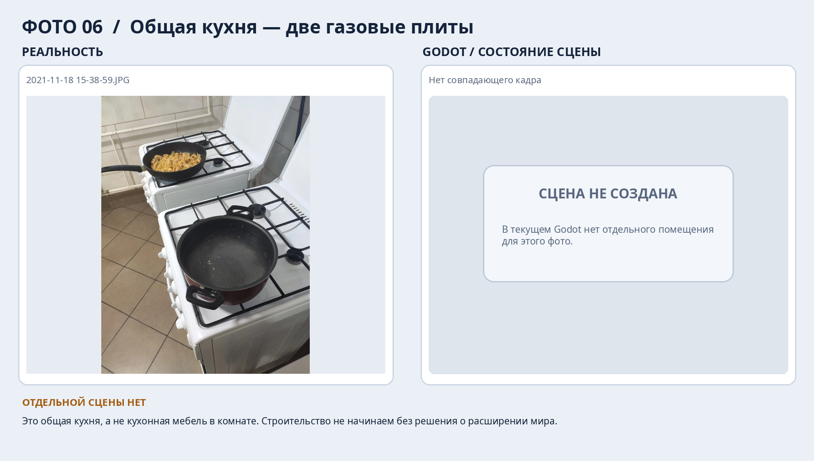

# Фото 06 — Общая кухня — две газовые плиты

**Источник:** `обшага.rar` → `обшага/2021-11-18 15-38-59.JPG`. **Проверено:** 23.11.2026.
**Игровой кадр:** соответствующей игровой сцены/кадра нет. отдельной сцены нет.
**Сравнение:** [`06-общая-кухня-фото-и-godot.png`](../../Графика/Кадры/Фотосверка_2026-11-23/06-общая-кухня-фото-и-godot.png).

## Что видно и что уже существует

- На фото две белые напольные газовые плиты с чёрными решётками и поднятыми верхними крышками.
- Позади видны светлые стены, крупный кафель, выступающие горизонтальные/вертикальные трубы; на полу квадратная коричневая плитка по диагонали.
- Кастрюля, сковорода и пища — временные предметы, не обязательные для постоянной 3D-сцены.
- В текущем проекте отдельной общей кухни нет. СВЧ и чайник в комнате не являются аналогом этих плит.

## Что исправить / проверить

| Приоритет | Действие | Статус |
|---|---|---|
| ОТЛОЖЕНО | Если потребуется выход из комнаты в общую кухню: сначала согласовать местоположение и связь с этажным коридором. | [ ] |
| P1 | При расширении сцены: две плиты, чёрные конфорки/решётки, открываемые крышки, трубы, кафель стен и диагональный рисунок пола. | [ ] |
| P3 | Не делать постоянными моделями еду и посуду из разового кадра без отдельного запроса. | [ ] |

**Состояние:** Не входит в существующую сцену; моделирование отложено.

**Достоверность:** справа использован только существующий снимок из рабочей папки, не новый рендер. Не считать несовпадение камер доказательством ошибки геометрии. Для отсутствующей сцены справа стоит обозначение «сцена не создана».

**Решение автора:** примечание о шторах из кадра `комната.JPG` убрано из списка недостатков: раздвинутые и закрытые занавеси — разные игровые состояния. Урна у лавок отложена и не моделировалась.

**Промежуточные архивы:** не создаются и не отправляются; всё войдёт в единый итоговый архив по отдельному запросу.
