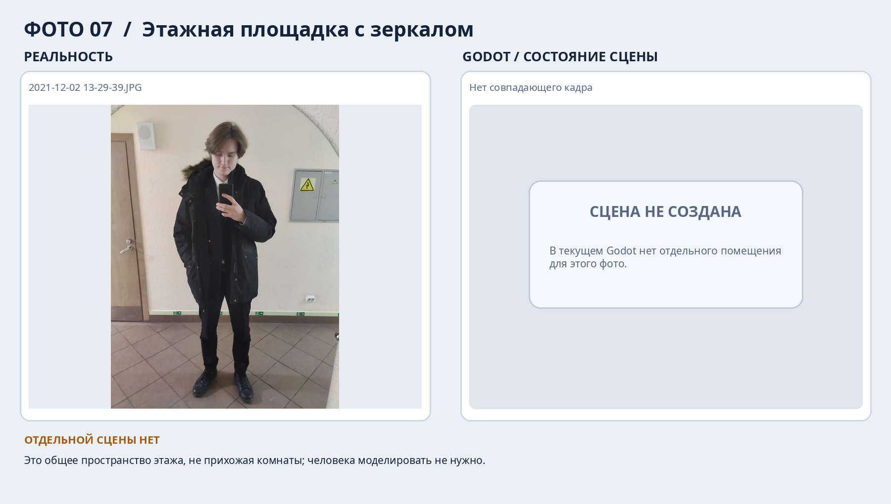

# Фото 07 — Этажная площадка с зеркалом

**Источник:** `обшага.rar` → `обшага/2021-12-02 13-29-39.JPG`. **Проверено:** 23.11.2026.
**Игровой кадр:** соответствующей игровой сцены/кадра нет. отдельной сцены нет.
**Сравнение:** [`07-этажная-площадка-зеркало-фото-и-godot.png`](../../Графика/Кадры/Фотосверка_2026-11-23/07-этажная-площадка-зеркало-фото-и-godot.png).
**Приватность:** на исходном фото есть люди. Сравнение хранится в рабочем каталоге `shots/`; не публиковать отдельно от личного проекта без согласования.

## Что видно и что уже существует

- Зеркальная фотография показывает светлую стену с мелкой фактурой, коричневую дверь слева, электрические щитки со знаками справа, светлый настенный блок над дверью.
- Внизу квадратная серая/бежево-серая плитка, уложенная по диагонали, тёмный плинтус, зелёная напольная маркировка.
- Зеркало с дугообразной верхней кромкой видно по краям кадра. Человек и телефон не являются частью архитектуры.
- В Godot общего этажного коридора / этой площадки пока нет (как и на фото 03).

## Что исправить / проверить

| Приоритет | Действие | Статус |
|---|---|---|
| ОТЛОЖЕНО | Объединить с отдельной задачей по коридору этажа (фото 03): сначала решить, нужна ли этажная зона в игре. | [ ] |
| P1 | Если нужна: добавить зеркало с дуговым верхом, электрические щиты, дверь, отделку и диагональную плитку. | [ ] |
| P2 | Сверить расположение зеркала относительно коридора по дополнительному ракурсу; не выводить геометрию только из селфи. | [ ] |

**Состояние:** Общей площадки нет; отдельная постройка отложена. Человек не моделируется.

**Достоверность:** справа использован только существующий снимок из рабочей папки, не новый рендер. Не считать несовпадение камер доказательством ошибки геометрии. Для отсутствующей сцены справа стоит обозначение «сцена не создана».

**Решение автора:** примечание о шторах из кадра `комната.JPG` убрано из списка недостатков: раздвинутые и закрытые занавеси — разные игровые состояния. Урна у лавок отложена и не моделировалась.

**Промежуточные архивы:** не создаются и не отправляются; всё войдёт в единый итоговый архив по отдельному запросу.
