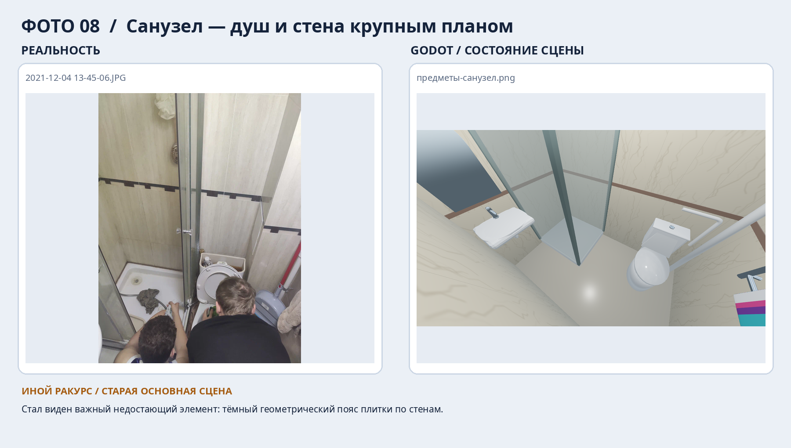

# Фото 08 — Санузел — душ и стена крупным планом

**Источник:** `обшага.rar` → `обшага/2021-12-04 13-45-06.JPG`. **Проверено:** 23.11.2026.
**Игровой кадр:** `shots/предметы-санузел.png` — ранее сохранённый кадр Godot. иной ракурс / старая основная сцена.
**Сравнение:** [`08-душ-санузел-фото-и-godot.png`](../../Графика/Кадры/Фотосверка_2026-11-23/08-душ-санузел-фото-и-godot.png).
**Приватность:** на исходном фото есть люди. Сравнение хранится в рабочем каталоге `shots/`; не публиковать отдельно от личного проекта без согласования.

## Что видно и что уже существует

- На фото душевая слева и унитаз справа; стекло в сером/зеленоватом металлическом профиле.
- На бежевой стеновой плитке проходит горизонтальный тёмный декоративный пояс с прямоугольными вставками.
- В поддоне круглый слив; на стеклянной створке видна небольшая ручка, на дне шланг и временные предметы.
- На фото идёт уборка/работа с открытым бачком и поднятой крышкой унитаза; люди и это временное состояние не должны фиксироваться как постоянная форма.
- В старой основной сцене декоративного пояса не видно, поддон плоский. В отдельной модели v2 уже предусмотрен слив, но пояс плитки и детальный профиль следует проверить.

## Что исправить / проверить

| Приоритет | Действие | Статус |
|---|---|---|
| P0 | Для точной проверки снять новый ракурс сверху вниз на душ и унитаз, желательно после интеграции санузла v2. | [ ] |
| P1 | Добавить или исправить тёмную горизонтальную декоративную полосу плитки с прямоугольным повторяющимся орнаментом; согласовать высоту по фото. | [ ] |
| P1 | Уточнить стеклянный профиль, небольшую ручку створки, слив и просвет/раму низкого поддона. | [ ] |
| P2 | Не копировать людей, случайный инвентарь и временно открытый бачок; крышка унитаза в обычном состоянии закрыта по первому фото. | [ ] |

**Состояние:** Новые требования к санузлу внесены в план. Основная сцена v2 не заменена.

**Достоверность:** справа использован только существующий снимок из рабочей папки, не новый рендер. Не считать несовпадение камер доказательством ошибки геометрии. Для отсутствующей сцены справа стоит обозначение «сцена не создана».

**Решение автора:** примечание о шторах из кадра `комната.JPG` убрано из списка недостатков: раздвинутые и закрытые занавеси — разные игровые состояния. Урна у лавок отложена и не моделировалась.

**Промежуточные архивы:** не создаются и не отправляются; всё войдёт в единый итоговый архив по отдельному запросу.

## Повторный кадр Godot

[Снимок 3:4](../../Графика/Кадры/Фотосверка_2026-11-23/08-душ-godot-3x4.png), камера из проёма. Локальная пара с частным фото: `shots/08-душ-фото-и-godot-v2.png`. Ракурс приближён по профилю и поясу отделки.

- У фото тёмный пояс с прямоугольными вставками, в игровом кадре видна сплошная коричневая полоса. На стене в игре прожилки контрастнее и крупнее.
- На фото у створки выступает короткая хромированная ручка, в игре на видимом профиле ручка не читается. У поддона на фото видны углубление и круглый слив, на игровом кадре поверхность выглядит плоской.
- Справа от душа на фото виден унитаз. В снятой локальной сцене унитаз на ожидаемом месте не виден. Сцена ссылается на санузел v2, а в кадре видны признаки старой отделки. Проверить локальную сборку и видимость модели перед выводами о расстановке.
