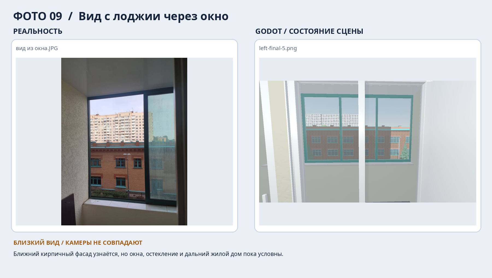

# Фото 09 — Вид с лоджии через окно

**Источник:** `обшага.rar` → `обшага/вид из окна.JPG`. **Проверено:** 23.11.2026.
**Игровой кадр:** `shots/left-final-5.png` — ранее сохранённый кадр Godot. близкий вид / камеры не совпадают.
**Сравнение:** [`09-вид-из-окна-фото-и-godot.png`](../../Графика/Кадры/Фотосверка_2026-11-23/09-вид-из-окна-фото-и-godot.png).

## Что видно и что уже существует

- На фото массивная тёмно-бирюзовая раздвижная рама, слегка тонированная створка справа, светлый подоконник с плиточным швом.
- За стеклом низкое рыже-кирпичное здание с зелёными рамами и выступающими кирпичными наличниками; дальше — бежевый многоэтажный дом с многочисленными лоджиями.
- В Godot эти объекты уже есть в упрощённом виде, но материалы рамы, детализация фасадов и масштаб окон/дальних балконов различаются.
- Игровой скрин сделан из более дальней точки за другой белой рамой. Нельзя по этой паре уверенно менять геометрию лоджии.

## Что исправить / проверить

| Приоритет | Действие | Статус |
|---|---|---|
| P0 | Снять кадр непосредственно с лоджии на той же высоте и с сопоставимым углом объектива, убрать из поля зрения внутреннюю белую дверь. | [ ] |
| P1 | Уточнить пропорции бирюзовых стоек, прозрачность/тонировку правой створки и рисунок плитки подоконника. | [ ] |
| P1 | Уточнить кирпичный фасад: светлый кирпич, цвет зелёных окон, кирпичные перемычки, карниз и расположение труб/фонарей. | [ ] |
| P2 | На дальнем доме вместо равномерной сетки добавить ритм лоджий и неоднородность фасада по доступным референсам. | [ ] |

**Состояние:** Экстерьер и лоджия уже в проекте; новых скриншотов Godot нет.

**Достоверность:** справа использован только существующий снимок из рабочей папки, не новый рендер. Не считать несовпадение камер доказательством ошибки геометрии. Для отсутствующей сцены справа стоит обозначение «сцена не создана».

**Решение автора:** примечание о шторах из кадра `комната.JPG` убрано из списка недостатков: раздвинутые и закрытые занавеси — разные игровые состояния. Урна у лавок отложена и не моделировалась.

**Промежуточные архивы:** не создаются и не отправляются; всё войдёт в единый итоговый архив по отдельному запросу.

## Повторная съёмка из Godot

[Игровой кадр](../../Графика/Кадры/Фотосверка_2026-11-23/09-повторный-кадр-godot.png). Локальная пара: `shots/09-фото-и-godot-v2.png`.

На фото слева проём даёт более чистый вид, справа стекло заметно холоднее и мутнее. В игровом кадре различие между соседними участками значительно слабее. На фото белая нижняя полка набрана плиткой с видимыми швами, в игре снизу читается сплошная светлая поверхность. У ближнего корпуса на фото выражены карниз и кирпичное обрамление окон. На дальнем фото читаются отдельные выступающие лоджии, в игре фасад выглядит как равномерная сетка. Точка камеры приблизительная, пропорции зданий проверять по дополнительным панорамам.
