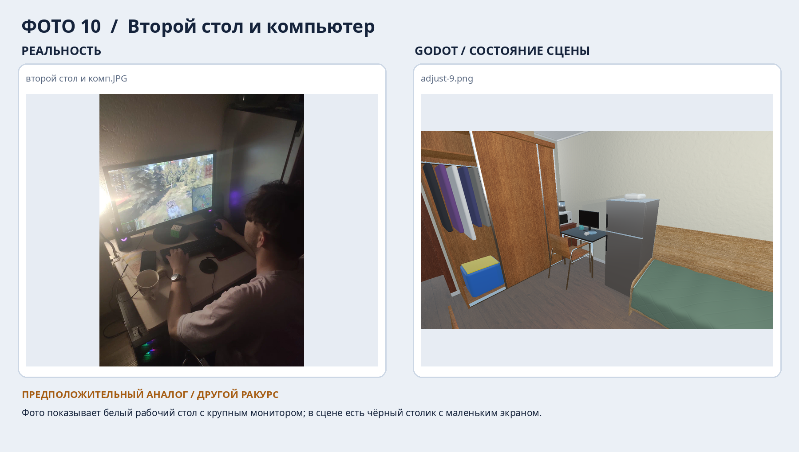

# Фото 10 — Второй стол и компьютер

**Источник:** `обшага.rar` → `обшага/второй стол и комп.JPG`. **Проверено:** 23.11.2026.
**Игровой кадр:** `shots/adjust-9.png` — ранее сохранённый кадр Godot. предположительный аналог / другой ракурс.
**Сравнение:** [`10-второй-стол-компьютер-фото-и-godot.png`](../../Графика/Кадры/Фотосверка_2026-11-23/10-второй-стол-компьютер-фото-и-godot.png).
**Приватность:** на исходном фото есть люди. Сравнение хранится в рабочем каталоге `shots/`; не публиковать отдельно от личного проекта без согласования.

## Что видно и что уже существует

- На фото светлая столешница, большой плоский монитор, клавиатура, мышь, колонки с подсветкой, кубик Рубика и системный блок с RGB-вентиляторами под столом.
- В Godot справа от шкафа расположен небольшой чёрный столик на металлических ножках, монитор маленький, системный блок отдельно по схеме.
- Фотография могла быть сделана при другой расстановке/в другом году: она сама по себе не отменяет авторскую утверждённую схему с чёрным столиком.
- Человек на фотографии и содержимое игры на мониторе не нужно переносить в 3D.

## Что исправить / проверить

| Приоритет | Действие | Статус |
|---|---|---|
| P0 | Уточнить, соответствует ли белый стол с фотографии тому же «второму столу», который сейчас показан чёрным в сцене, или это иная конфигурация. | [ ] |
| P1 | При подтверждении: проверить реальную ширину стола, пропорции монитора, размещение системника под ним, колонки и провода. | [ ] |
| P2 | Сравнить мелкие предметы (кубик, кружка, телефон, коврик) как возможные интерактивные пропсы — без обязательного копирования временного беспорядка. | [ ] |
| P2 | Сделать скрин с близкого верхнего угла у второго рабочего места. | [ ] |

**Состояние:** До подтверждения соответствия стола мебель не переставлялась.

**Достоверность:** справа использован только существующий снимок из рабочей папки, не новый рендер. Не считать несовпадение камер доказательством ошибки геометрии. Для отсутствующей сцены справа стоит обозначение «сцена не создана».

**Решение автора:** примечание о шторах из кадра `комната.JPG` убрано из списка недостатков: раздвинутые и закрытые занавеси — разные игровые состояния. Урна у лавок отложена и не моделировалась.

**Промежуточные архивы:** не создаются и не отправляются; всё войдёт в единый итоговый архив по отдельному запросу.
