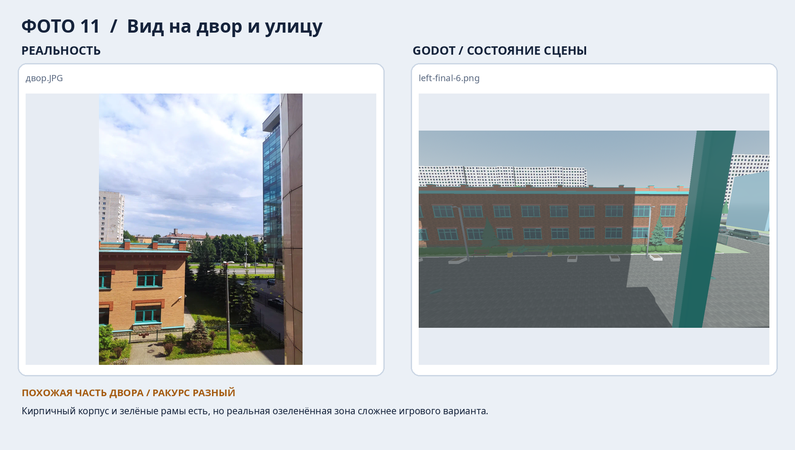

# Фото 11 — Вид на двор и улицу

**Источник:** `обшага.rar` → `обшага/двор.JPG`. **Проверено:** 23.11.2026.
**Игровой кадр:** `shots/left-final-6.png` — ранее сохранённый кадр Godot. похожая часть двора / ракурс разный.
**Сравнение:** [`11-двор-и-улица-фото-и-godot.png`](../../Графика/Кадры/Фотосверка_2026-11-23/11-двор-и-улица-фото-и-godot.png).

## Что видно и что уже существует

- На фото справа — фасад современного здания с крупным голубым остеклением; слева — низкий кирпичный корпус с бирюзовыми окнами.
- Между корпусами видны деревья, низкие кусты, газон, дорожка, ограда, фонарный столб, дорога за двором и дальние дома.
- На игровом кадре корпус и цвет рам узнаваемы, однако в ближнем плане преобладает большая сплошная мощёная площадка, а застройка и деревья выполнены упрощённо.
- Камера игры повернута в сторону фасада, поэтому наличие/отсутствие правого стеклянного здания по этому скриншоту оценивать нельзя.

## Что исправить / проверить

| Приоритет | Действие | Статус |
|---|---|---|
| P0 | Снять внешний кадр с высоты окна, повернувшись вправо до появления тех же двух зданий и полосы улицы. | [ ] |
| P1 | Сверить площадь и границы газона, дорожек, кустов, ограды и группы крупных деревьев между зданиями. | [ ] |
| P1 | Проверить пропорции кирпичного корпуса, количество/размер окон, высоту крыши, цвет рам и кирпича. | [ ] |
| P2 | При совпавшем ракурсе добавить/уточнить стеклянный фасад справа, уличные фонари и более дальнюю застройку. | [ ] |

**Состояние:** Двор в проекте есть; точное сравнение требует новой камеры.

**Достоверность:** справа использован только существующий снимок из рабочей папки, не новый рендер. Не считать несовпадение камер доказательством ошибки геометрии. Для отсутствующей сцены справа стоит обозначение «сцена не создана».

**Решение автора:** примечание о шторах из кадра `комната.JPG` убрано из списка недостатков: раздвинутые и закрытые занавеси — разные игровые состояния. Урна у лавок отложена и не моделировалась.

**Промежуточные архивы:** не создаются и не отправляются; всё войдёт в единый итоговый архив по отдельному запросу.

## Повторная съёмка из Godot

[Игровой кадр](../../Графика/Кадры/Фотосверка_2026-11-23/11-повторный-кадр-godot.png). Локальная пара: `shots/11-фото-и-godot-v2.png`.

Расположение кирпичного фасада слева и синего остекления справа воспроизведено приблизительно. На фото кусты, ели и ограда делят двор на небольшие участки, в кадре Godot много открытой сплошной брусчатки, кусты образуют ровную полосу. На фото справа видна близкая глухая облицовка стены, а игровой вид открывает светлую сетку фасада. Сверить правую границу с панорамами перед изменением геометрии. Линию крыши и площадь неба не использовать как обмер.
