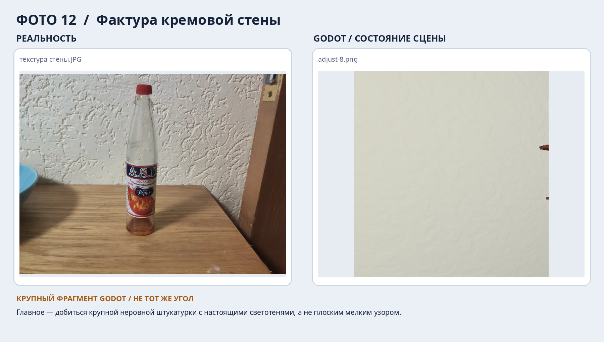

# Фото 12 — Фактура кремовой стены

**Источник:** `обшага.rar` → `обшага/текстура стены.JPG`. **Проверено:** 23.11.2026.
**Игровой кадр:** `shots/adjust-8.png` — ранее сохранённый кадр Godot. крупный фрагмент godot / не тот же угол.
**Сравнение:** [`12-текстура-стены-фото-и-godot.png`](../../Графика/Кадры/Фотосверка_2026-11-23/12-текстура-стены-фото-и-godot.png).

## Что видно и что уже существует

- На фото сильно выраженная структурная кремово-белая штукатурка с крупными неровными островками рельефа и боковыми тенями.
- На сохранённом дневном игровом кадре материал светлый и фактурный, но рельеф кажется мелким и довольно плоским, особенно вдалеке.
- На исходном снимке также столешница тёплого дерева, частично чаша/таз и бутылка; акцент этого кадра — фактура стены, а не временные предметы.
- Игровой кадр увеличен по фрагменту стены без дорисовки деталей; масштаб сравниваемых участков различается.

## Что исправить / проверить

| Приоритет | Действие | Статус |
|---|---|---|
| P0 | Сделать крупный игровой скрин стены с расстояния около 0,5–1 м при боковом дневном свете. | [ ] |
| P1 | Подогнать масштаб рельефного рисунка, а не только цвет: крупные неоднородные фрагменты, более отчётливые светлые пики и тёмные углубления. | [ ] |
| P1 | Проверить нормаль/бамп и повторение текстуры без явных стыков; использовать умеренную глубину, чтобы не превращать штукатурку в камень. | [ ] |
| P2 | Тёплый оттенок стены сверить при нейтральном освещении. Бутылку на фото не считать обязательным предметом. | [ ] |

**Состояние:** Текущие материалы не менялись; задача на настройку материалов и контрольный скрин.

**Достоверность:** справа использован только существующий снимок из рабочей папки, не новый рендер. Не считать несовпадение камер доказательством ошибки геометрии. Для отсутствующей сцены справа стоит обозначение «сцена не создана».

**Решение автора:** примечание о шторах из кадра `комната.JPG` убрано из списка недостатков: раздвинутые и закрытые занавеси — разные игровые состояния. Урна у лавок отложена и не моделировалась.

**Промежуточные архивы:** не создаются и не отправляются; всё войдёт в единый итоговый архив по отдельному запросу.

## Повторная съёмка из Godot

[Игровой кадр](../../Графика/Кадры/Фотосверка_2026-11-23/12-повторный-кадр-godot.png). Локальная пара: `shots/12-фото-и-godot-v2.png`.

Фото показывает крупные островки штукатурки с резкими кромками и тенями внутри углублений. В Godot рельеф мягче и менее контрастный, граница света размазывается, рисунок местами выглядит повторяющимся. Сверены близкие планы у деревянной поверхности и двери. Бутылка на исходнике задаёт приблизительный масштаб, а разница света мешает оценить глубину рельефа в миллиметрах.
