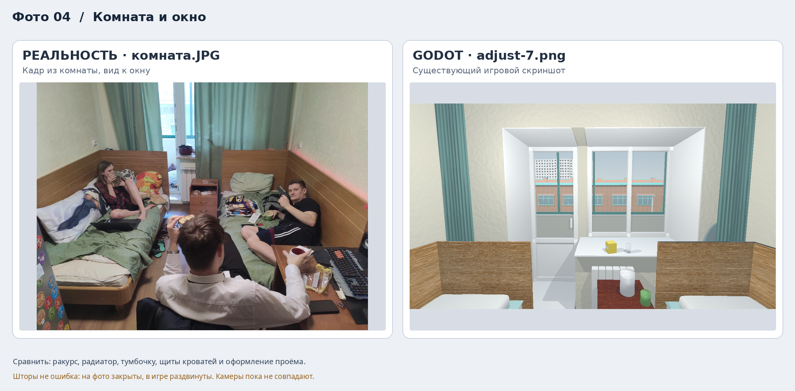

# Фото 04 — комната, вид к окну (`комната.JPG`)

**Разбор:** 23.11.2026.  
**Источник:** архив `обшага.rar`, файл `обшага/комната.JPG`. В кадре люди, поэтому **оригинал не копировался в публичную папку `Фото_референсы`**; исходник остаётся в предоставленном архиве / закрытой локальной рабочей копии.  
**Игровой кадр:** [`shots/adjust-7.png`](../../Графика/Кадры/Фотосверка_2026-11-23/adjust-7.png) — реальный сохранённый скриншот из текущего проекта Godot, камера ближе к окну, чем на фото.  
**Сравнение:** [`shots/комната-фото-и-godot.png`](../../Графика/Кадры/Фотосверка_2026-11-23/комната-фото-и-godot.png) (включает исходный кадр с людьми; **не публиковать без отдельного разрешения**).

## Видимые детали исходного фото

- Две односпальные кровати **вдоль боковых стен** с высокими деревянными щитами у окна и длинными горизонтальными панелями вдоль стены. Вещи, текстиль и люди занимают значительную часть кадра — они не являются обязательными постоянными объектами для 3D-модели.
- **Между кроватями** у стены окна — небольшая деревянная тумбочка с **открытой нишей сверху и ящиками снизу**. На ней лежат мелочи; это не сигнал переносить расстановку из временного кадра буквально.
- Сзади — **плотные серо-бирюзовые шторы**, белая ПВХ-рама, проём в лоджию/у окна и **белый секционный радиатор** под оконной частью. Ткань закрывает существенную часть остекления.
- Деревянные щиты выглядят тёпло-золотистыми и сравнительно гладкими, с читаемыми **горизонтальными стыками**. Пол — тёплый древесный, виден лишь в узком проходе.
- На боковых стенах — кремовые мелкофактурные обои над щитами, справа видна розово-красная локальная подсветка. По одному дневному кадру нельзя калибровать силу свечения и точный RGB отделки.
- Фото показывает комнату с людьми в определённый момент времени. **Не использовать этот кадр для изменения стороны балконной двери** или иных решений, ранее подтверждённых автором по схеме и дополнительным изображениям.

## Что уже совпадает в текущем Godot (по `adjust-7.png` и существующей сцене)

- Направление обзора к окну, **две кровати по сторонам**, высокие деревянные изголовья/щиты; между ними тумбочка.
- Есть светлая оконно-балконная группа, зелёно-бирюзовые шторы, **радиатор** под окном и деревянная отделка возле кроватей.
- На скрине виден **более близкий план**: основания кроватей и часть помещения, показанная на реальной фотографии, находятся вне кадра, поэтому их размеры здесь напрямую не сравнить.

**Уточнение автора:** шторы не являются расхождением: на фотографии они закрыты, а в Godot раздвинуты. **Никаких изменений штор по этому кадру не требуется.**

## Расхождения и что исправить

| Приоритет | Наблюдение | Действие / проверка | Статус |
|---|---|---|---|
| P0 | **Камеры не совпадают по расстоянию и охвату.** На фото видны почти обе кровати до изножий, в Godot — лишь их верхние части. | Поставить проверочную камеру **со стороны входа в комнату** на аналогичную высоту и направить к центру окна; подобрать FOV, не меняя размеров сцены ради первого приблизительного кадра. Сделать новый снимок Godot и вторую точную пару. | [ ] |
| P1 | Реальный шпон щитов **более ровный и тёпло-золотистый**; в Godot заметная контрастная «шероховатая» древесная текстура. | Снизить контраст/частоту древесного шума на щитах и согласовать оттенок с другими авторскими референсами при дневном освещении. | [ ] |
| P1 | **Радиатор и низ оконного блока** на фото видны между кроватями за тумбочкой. В Godot белые секции выглядят геометрически крупными, а конструкция подоконника/оконно-балконной группы отличается визуально. | Сверить **количество, ширину и высоту секций**, размер подоконника и глубину ниши по крупному фото окна. Не переносить автоматически сторону балконной двери. | [ ] |
| P1 | Тумбочка в реальности имеет открытую верхнюю нишу, ниже ящики; игровой скрин частично скрывает её передним планом, и содержимое отличается. | Проверить компоновку по отдельному крупному референсу; в проекте она уже описана как правильная, **без доказательства ошибки не переделывать**. | [ ] |
| P2 | Свет в реальном кадре мягкий, есть слабый красный отсвет справа; в игровом кадре ровный холодный дневной свет. | Позже подобрать отдельный режим/интенсивность подсветки и мягкий свет окна, не превращая всю комнату в розовую. Учитывать разную экспозицию источников. | [ ] |
| P3 | Люди, еда, упаковки, ноутбук на кровати и прочая случайная обстановка — переменные детали. | **Не моделировать** людей и случайные вещи без отдельного решения автора. Постоянную мебель оставить по ранее утверждённой схеме. | [x] |

## Зафиксированный результат

- [x] Фото и существующий игровой кадр просмотрены.
- [x] Сравнительная картинка создана в `shots/` и содержит честную пометку о несовпадении камер.
- [x] Выявленные задачи записаны в рабочий план.
- [x] Переснят близкий ракурс в Godot с камеры со стороны входа.
- [ ] Выполнены материалы, ткань, геометрия и проверка после изменений.

**Изменения 3D-геометрии:** не вносились. **Архив:** не формируется и не передаётся до отдельного запроса автора.

## Повторная съёмка из Godot

[Игровой кадр 4:3](../../Графика/Кадры/Фотосверка_2026-11-23/04-комната-godot-4x3.png). Пара с частным фото сохранена локально в `shots/04-комната-фото-и-godot-v2.png`. Камера Godot: позиция (1,01; 1,78; −1,61) м, наклон −25°, поворот −93°, вертикальный FOV 58°. Ракурс приближён по углам щитов и оконному блоку. Остаток расхождения перспективы не позволяет обмерять проход по кадру.

- **Щиты кроватей.** На фото дерево гладкое, с явными горизонтальными стыками. В Godot контрастный мелкий рисунок дерева перекрывает линии стыков.
- **Изножье слева.** На фото низкая скруглённая рама заметна под матрасом. В Godot перед ним выступает деревянный торец, видимый рядом со свисающим покрывалом. Проверить профиль обеих деталей по фото кровати.
- **Тумбочка.** Верхняя открытая ниша на новом кадре видна и совпадает по компоновке. Отличаются цвет шпона и ручки: на фото видны дугообразные ручки, в Godot — маленькие квадратные.
- **Постель.** Игровые покрывала повторяют один рисунок складок, а подушки выглядят плоскими прямоугольными блоками. На фото поверхность ткани и силуэт подушки справа заметно мягче и неровнее.
- **Подсветка.** Справа над щитом на фото виден слабый красный отсвет, игровой кадр снят в дневном режиме. Для отдельной проверки света нужен кадр с включённой красной лентой.

Положение штор — авторское решение. По этому ракурсу размеры радиатора и прохода остаются непроверенными.
