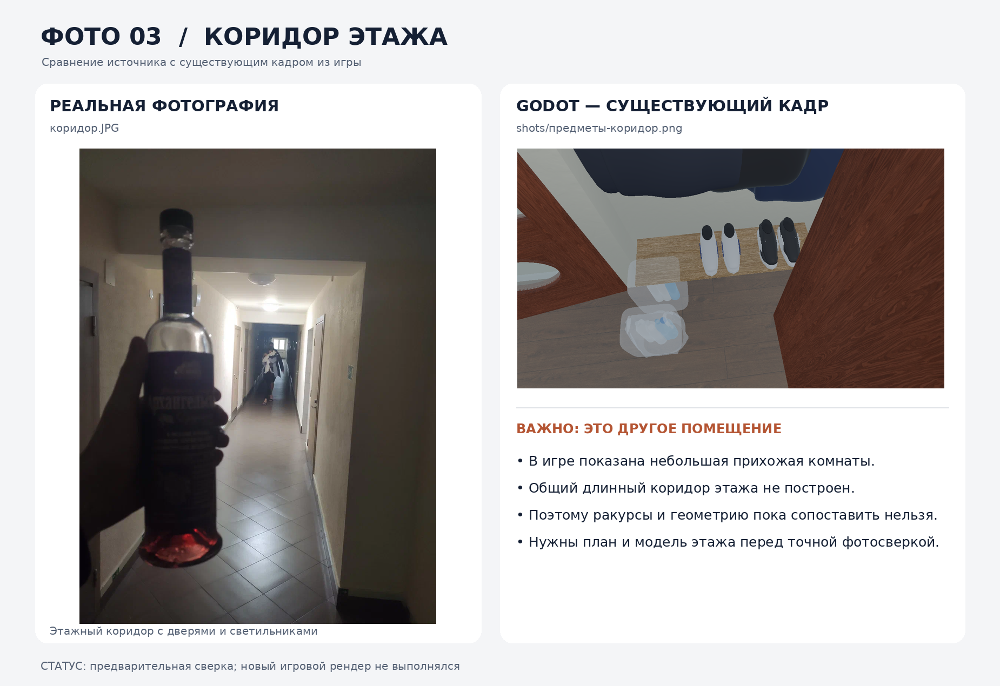

# Фото 03 — общий коридор этажа (`коридор.JPG`)

**Дата разбора:** 23.11.2026  
**Оригинал:** `обшага.rar/обшага/коридор.JPG`, рабочая закрытая копия: `референсы_локально/фото_архив_2026-11-23/коридор.JPG`. На фотографии присутствует человек, поэтому исходник не помещён в папку публичных референсов.  
**Существующий кадр Godot:** [`shots/предметы-коридор.png`](../../Графика/Кадры/Фотосверка_2026-11-23/предметы-коридор.png), **маленький коридор внутри комнаты, не тот же коридор**.  
**Сохранённая картинка с пояснениями:** [`shots/коридор-этажа-фото-и-godot.png`](../../Графика/Кадры/Фотосверка_2026-11-23/коридор-этажа-фото-и-godot.png).  
**Ограничение:** сопоставление только предварительное: нет соответствующей модели длинного коридора и игрового скриншота с того же ракурса. Изображение справа — реальный старый скрин из Godot, не реконструкция и не новый рендер.

## Что достоверно видно на реальном фото

- Это **общий длинный коридор этажа общежития**. Он не совпадает с короткой личной прихожей комнаты, которая описана в исходном плане.
- Длинная прямая перспектива: боковые стены сходятся к тёмному проёму/участку и **небольшому светлому окну** в дальнем конце.
- **Светлые кремово-бежевые стены**, более тёмный нижний плинтус/полоска у основания, относительно низкий светлый потолок.
- На полу **крупная серая квадратная плитка, уложенная по диагонали**; швы хорошо видны. В одном кадре размеры плитки в метрах надёжно не определяются.
- По обеим сторонам — **несколько дверных проёмов и дверей**, справа ближе к фотографу видна светлая закрытая дверь с металлической ручкой. Не следует придумывать точное количество дверей по скрытым участкам.
- На потолке видны **круглые накладные плафоны**, разная яркость по глубине, свет у дальнего участка.
- На переднем плане — рука и большая бутылка, перекрывающие часть изображения. Далеко в коридоре виден человек. **Это случайные объекты съёмки**, без отдельного решения автора не переносить их в игровую сцену.

## Что есть в текущем проекте

- В [`blender/комната.py`](../../blender/комната.py) построена лишь личная прихожая примерно 2,2 × 1,15 м и маленькая **техническая площадка за входной дверью**; в исходнике прямо написано, что за её пределами здание не реконструировано.
- Плоскости прихожей отделаны деревом/ламинатом и стенами комнаты — это не плиточный этажный коридор на фото.
- `shots/предметы-коридор.png` показывает обувь и пол у внутренней двери. Скриншот нельзя считать видом вдоль общего коридора: ни перспектива, ни отделка, ни окружение не соответствуют фото.

## Список исправлений и задач

| Приоритет | Задача | Где и как | Состояние |
|---|---|---|---|
| P0 | **Определить объём проекта:** нужен ли длинный общий коридор этажа как доступная часть игры или только вид из входной двери. Фотография даёт референс, но не подтверждает необходимость строить весь этаж. | Решение автора; записать в план | [ ] |
| P0 | **Не путать общий коридор с прихожей.** Не менять короткий коридор комнаты по этому фото; это другой участок. | `blender/комната.py`, `scenes/dorm.tscn` | [x] |
| P1 | Если внешний коридор входит в объём работ — заменить временную площадку **отдельным участком длинного прямого коридора**, состыкованным с входной дверью без разрушения интерьера комнаты. | `blender/комната.py` либо новая отдельная сцена/модель | [ ] |
| P1 | Сделать **серую квадратную плитку с диагональной укладкой**, контрастными швами; определить приблизительный шаг по геометрии дверей и перспективе (без выдумывания точных размеров). | Геометрия/материал пола | [ ] |
| P1 | Выстроить линию **кремовых стен, несколько дверных проёмов справа и слева, плинтусы и дальнее окно**. Число скрытых дверей уточнить другим кадром, если будет. | Модель этажного коридора | [ ] |
| P1 | Разместить **несколько круглых светильников на потолке**, настроить яркость вдоль коридора, свет из дальнего окна, неравномерный свет и тени. | Освещение сцены | [ ] |
| P2 | Сделать **новый скриншот именно из Godot** с точки вдоль коридора; подобрать высоту, вертикальный FOV и угол по линиям стен и швам плитки. | Камера проверки / `shots/коридор-этажа-godot-v2.png` | [ ] |
| P2 | После моделирования заменить предварительное сравнение **точной парой кадров**, сохранив старую проверку для истории. | `shots/коридор-этажа-фото-и-godot-v2.png` | [ ] |
| P3 | Бутылку, руку, человека и читаемые марки не моделировать без отдельной просьбы. | Только окружение | [x] |

## Проверка статуса

- [x] Исходное фото просмотрено; отличено от коридора внутри комнаты.
- [x] Реальный скриншот из существующего проекта найден и использован **с предупреждением, что он показывает другое помещение**.
- [x] Предварительная сравнительная картинка создана, задачи сохранены в проекте.
- [ ] В основную сцену добавлен этажный коридор.
- [ ] Получен новый скриншот Godot с сопоставимого ракурса.

**Изменения геометрии:** не выполнялись. **Доступность Godot/Blender:** в данной среде исполняемые приложения отсутствуют; проверить новый игровой рендер не удалось. **Общий архив:** пока не выпускается по просьбе автора.
