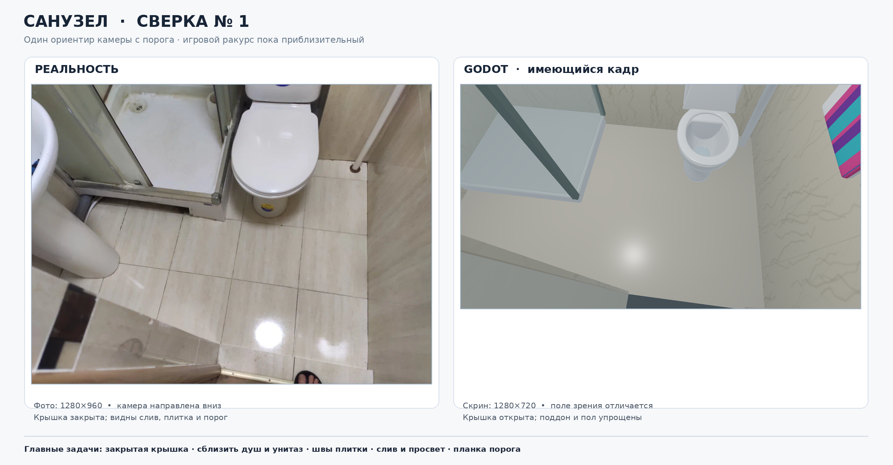

# Санузел — сверка по фото 01 (`туалет.JPG`)

**Дата:** 23.11.2026  
**Референс:** [`Фото_референсы/07-санузел-с-порога.jpg`](../../Фото_референсы/07-санузел-с-порога.jpg) (из пользовательского архива `обшага.rar/обшага/туалет.JPG`).  
**Игровой кадр:** [`shots/санузел-сверка.png`](../../Графика/Кадры/Фотосверка_2026-11-23/санузел-сверка.png) — сохранённый ранее скриншот, **не новый рендер**.  
**Сравнение:** [`shots/санузел-фото-и-godot.png`](../../Графика/Кадры/Фотосверка_2026-11-23/санузел-фото-и-godot.png).

## Что реально видно на фото

- **Унитаз**: крышка опущена; сливной бачок виден у верхнего края. Унитаз стоит очень близко к душевому ограждению.
- **Душ**: белое дно со сливом ближе к заднему левому углу. По передней стороне идёт металлический профиль; под профилем/основанием есть заметный тёмный просвет.
- **Пол**: светлая бежевая **квадратная плитка** со швами, чуть отличающимися от плитки по тону. В нижней части — металлическая планка порога.
- **Слева**: край белой раковины и её пьедестал. **Справа**: белая труба с вводом в пол возле стены.
- **Стены**: бежевое покрытие с приглушённой фактурой, без настолько выраженных прожилок, как на игровом кадре.

## Отличия от сохранённого кадра игры

| Приоритет | Что не совпадает | Где исправлять | Готово |
|---|---|---|---|
| P0 | Крышка унитаза открыта; на фото закрыта | `models/предметы/toilet.glb`, подключение в `scenes/dorm.tscn` | [ ] |
| P0 | Между душем и унитазом слишком большой визуальный зазор | душ в `blender/комната.py`, положение унитаза в `scenes/dorm.tscn`; проверить размеры и коллизии | [ ] |
| P0 | Сплошной блок душевого поддона вместо белого дна с видимым сливом и просветом под рамой | `blender/комната.py` | [ ] |
| P0 | Пол однотонный: нет квадратной плитки, швов и рисунка | материал `плитка_су` и геометрия пола в `blender/комната.py` | [ ] |
| P1 | Не читается металлическая планка порога | проём санузла в `blender/комната.py` | [ ] |
| P1 | Труба справа не выглядит как на фото, её видимость и положение проверить | `blender/комната.py`, `blender/детали.py` | [ ] |
| P1 | Раковина на реальном фото сильнее входит в кадр слева | позиция `Раковина` в `scenes/dorm.tscn` **или** калибровка камеры; сначала проверить ракурс | [ ] |
| P2 | Фактура бежевых стен заметно отличается | `blender/текстуры.py`, `blender/детали.py` | [ ] |
| P0 (сверка) | Сохранённый кадр имеет другой угол/поле зрения и формат 16:9 против 4:3 фото; точное попиксельное совмещение нельзя считать выполненным | повторить снимок в Godot из точки порога в формате 4:3, скорректировать наклон и FOV | [ ] |

## Порядок работ

1. В Blender/Godot сначала восстановить **камеру с порога** по реальному фото (нижняя часть проёма, унитаз справа, душ слева), сделать повторный снимок в соотношении **4:3**. Только после этого оценивать расстояния по изображению.
2. Закрыть крышку унитаза (при необходимости заменить/скорректировать модель), затем сблизить душевое ограждение с унитазом **с проверкой фактических габаритов** — не подгонять расстояние по одному искажённому снимку.
3. Переделать поддон: вогнутое дно, круглый слив, передняя металлическая рама, тёмный просвет под ней.
4. Добавить материал квадратной плитки с видимыми швами, затем порожек и уточнить трубу справа.
5. Пересобрать `models/общага.glb` и `models/подвижные.json` одним экспортом, импортировать в Godot, проверить визуально, маршрут и коллизии.
6. Повторить сравнение после правок: сохранить **новый** скриншот с обозначением версии и не выдавать старый кадр за исправленный.

## Статус

- [x] Фото найдено в архивах и сопоставлено с референсом проекта.
- [x] Сравнительная картинка «реальность / Godot» создана.
- [x] Расхождения внесены в план.
- [ ] 3D-модель исправлена и пересобрана.
- [ ] Новый скриншот из Godot получен и проверен.
- [x] Вторая фотография (`урна.JPG`) выбрана и разобрана отдельно в [сверке урны](Сверка_урны_2026-11-23.md); санузел в основной сцене пока не исправлен.

**Ограничение этой сверки:** здесь использован существующий снимок из проекта; исполняемый Godot и Blender в этой среде отсутствуют, поэтому новый рендер сцены и проверка коллизий не выполнялись.

## Обнаружен второй пакет — `obshaga_complete_pack.zip` (23.11.2026)

Пути в этом разделе относятся к архивной копии проекта. В репозитории утверждённый санузел хранится в [каталоге моделей](../../models/утверждённые/README.md).

В отдельном пакете есть **новая готовая модель `bathroom_full_v2.glb`** (координаты уже в метрах и формате glTF) с закрытой крышкой унитаза, сливом и передним профилем душа, швами плитки, порожком, трубой с фланцем, раковиной-тюльпаном, зеркалом и полотенцами. В пакете также есть отдельные модели `sink.glb`, `toilet.glb`, `shower_tray.glb`, `striped_towel.glb`, `grey_towel.glb`.

- [Сравнение реального фото, старого Godot и нового превью](../../Графика/Кадры/Фотосверка_2026-11-23/санузел-три-версии.png). **Третий кадр — предоставленное превью 3D-модели, а не новый рендер Godot**. Он показывает наличие деталей, но не доказывает точность размеров/ракурса.
- [Полное превью модели из архива](../../Графика/Кадры/Фотосверка_2026-11-23/санузел-v2-превью-из-пакета.png).
- Модели скопированы в `models/props_pack/`. Для безопасного осмотра есть **отдельная** сцена `scenes/bathroom_v2_preview.tscn` (в Godot открыть её и нажать **F6**). Основная `scenes/dorm.tscn` **не заменена** и продолжает показывать старую геометрию.
- Важная техническая проблема: старые пол, поддон, стекло и панели санузла экспортированы **внутри объединённого узла** `Комната и двор` в `models/общага.glb`, а раковина и унитаз уже добавлены отдельными сценами в `scenes/dorm.tscn`. Скрипт из ZIP, который только скрывает узлы по имени, **не удалит** старые части внутри объединённого меша. Прямое наложение `bathroom_full_v2.glb` вызовет дубли и потенциальное z-fighting.
- Правильное подключение в основную сцену: изменить генератор Blender, чтобы *не экспортировать старые* элементы санузла (с сохранением проёмов, стен коридора, коллизий дверей и перемещения игрока), встроить новую модель в нужную точку, убрать старые отдельные сантехнические модели, **перегенерировать `общага.glb`**, переимпортировать в Godot и проверить коллизии. Альтернатива — разделить старый объединённый меш по объектам, затем скрыть только санузел.

**Задачи по результатам пакета:**

- [x] Найдена новая геометрия, перекрывающая основные визуальные замечания по фото 01.
- [x] В проект добавлены исходные `.glb`, превью, тройное сравнение и отдельная сцена просмотра.
- [ ] Проверить масштаб, направление стен и привязку к порогу на реальном запуске Godot.
- [ ] Удалить старую геометрию санузла при интеграции, не ломая коллизии и двери.
- [ ] Получить кадр **новой** модели прямо в Godot с того же ракурса 4:3 и проверить каждую деталь.
- [x] Следующее фото 02 (`урна.JPG`) разобрано отдельно; это не означает завершения установки санузла v2 в основной сцене.

## Проверка санузла v2 в основной сцене

[Свежий кадр 4:3](../../Графика/Кадры/Фотосверка_2026-11-23/01-санузел-godot-4x3.png). На повторном запуске видны закрытая крышка, плиточные швы, ввод трубы и просвет под профилем. Унитаз теперь рядом с душем. Раковина всё ещё за краем этого игрового кадра, металл порога и положение раковины требуют отдельной проверки. Коллизии этой фотосверкой не проверялись. Парный кадр: `shots/01-фото-и-godot-v2.png`.

## После установки и проверки прохода

В основной сцене используется санузел v2. На [кадре с порога 4:3](../../Графика/Кадры/Проверка_интеграции_2026-11-23/санузел-после-4x3.png) видны раковина на пьедестале, закрытый унитаз рядом с душем и геометрический пояс. На [снимке стыка](../../Графика/Кадры/Проверка_интеграции_2026-11-23/санузел-порог.png) читаются порожек, его примыкания к косякам и переход пола. В Godot проверено открывание двери и проход игрока через порог в обе стороны.
