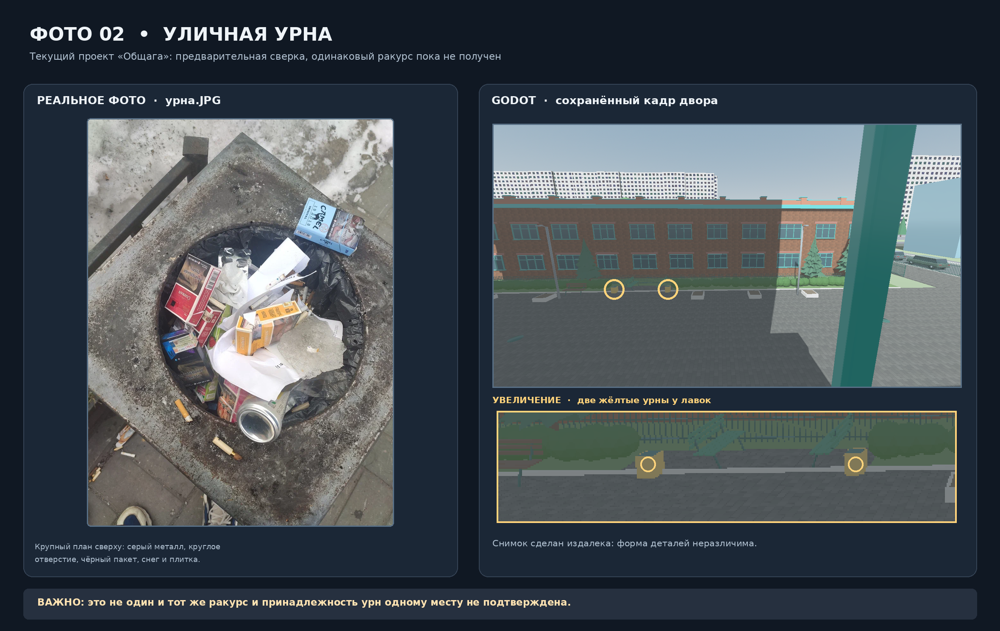

# Фото 02 — уличная урна (`урна.JPG`)

**Дата разбора:** 23.11.2026  
**Оригинал:** `обшага.rar/обшага/урна.JPG`; копия без изменения содержания: [`Фото_референсы/08-урна.jpg`](../../Фото_референсы/08-урна.jpg).  
**Имеющийся кадр Godot:** [`Графика/Кадры/двор-с-лоджии.png`](../../Графика/Кадры/двор-с-лоджии.png), общий план двора, не ракурс с фото.  
**Сохранённое сравнение:** [`shots/урна-фото-и-godot.png`](../../Графика/Кадры/Фотосверка_2026-11-23/урна-фото-и-godot.png). Имеющийся игровой кадр использован как есть, с подписанным увеличением видимых урн; **новый скриншот Godot не делался**.

## Уточнение автора (23.11.2026)

Автор подтвердил, что **серая урна на снимке находится на улице во дворе возле лавок**. Это снимает вопрос о районе размещения, но **не означает**, что она точно является одной из двух жёлтых урн на старом игровом кадре: внешний вид может отличаться из-за модели/ракурса/времени. Автор прямо попросил **пока урну не делать и перейти к следующему фото**. Статус работы: **отложено**. Никакие урны в 3D-сцене не менять до возвращения к задаче.

## Что видно на исходной фотографии

- Объект снят **почти вертикально сверху**, под углом относительно сторон квадратной верхней плиты.
- Верх выполнен из **серого, потёртого и местами загрязнённого металла**. Форма сверху квадратная, а **приёмное отверстие крупное и круглое**.
- В отверстии виден **чёрный мусорный пакет** и содержимое (бумага, картон, упаковки и банка). На верхней поверхности и рядом — мелкий мусор. Конкретные надписи и бренды моделировать не требуется.
- Слева тянется тёмная металлическая перекладина/ограждение; на фоне видны **плитка тротуара** и снег. По одному кадру нельзя установить точное место этой урны во дворе или её габариты.

## Что удалось найти в текущей 3D-сцене

В [`blender/детали.py`](../../blender/детали.py) у двух зелёных лавок двора создаются **две жёлтые урны**: массивный прямоугольный ящик `урна_жёлтая` с **плоской верхней пластиной** `урна_верх`. В коде каждой задан размер основания примерно **0,44 × 0,44 м** и высота около **0,55 м**; это размеры **игровой модели, не измерения с реального фото**. Верхняя пластина не имеет выреза под круглое отверстие.

Обе игровые урны маленькие в сохранённом кадре с лоджии, так что точное сравнение деталей невозможно. На панорамах двора, уже сохранённых в проекте (`Фото_референсы/Двор_2026-11-23/08...` и `09...`), **жёлтые урны у зелёных лавок тоже видны**. Поэтому нельзя без дополнительного подтверждения объявить их неправильными и заменить урной с нового снимка. Возможно, это **другой объект, другое место или другое время**.

## Расхождения, гипотезы и план исправления

| Приоритет | Задача | Где выполнять | Статус |
|---|---|---|---|
| P0 | **Установить, относится ли серо-металлическая урна к тому же месту**, что жёлтые урны у зелёных лавок. Не подменять их друг другом до подтверждения. | Сверить `урна.JPG`, панорамы двора и планировку | [ ] |
| P0 | **Снять реальный кадр Godot с точки над урной**, максимально близко к ракурсу фото (план сверху, квадратная крышка по диагонали). | Камера в `scenes/dorm.tscn`, временная свободная камера и `--shot` | [ ] |
| P0 | После подтверждения места решить: **новая отдельная серая урна** или замена определённого объекта. Сохранить две жёлтые урны, если панорамы подтверждают их расположение. | `blender/детали.py` / сцена двора | [ ] |
| P1 | Для **серой урны** сделать квадратную верхнюю панель с **настоящим круглым сквозным отверстием**, внутренним тёмным объёмом и чёрным мешком; не сплошную крышку. | Новый объект/генератор в Blender, экспорт через `blender/экспорт.py` | [ ] |
| P1 | Воспроизвести **грязный, неоднородный металл**, тёмную опорную перекладину слева, кромку круглого выреза. Материал не должен быть равномерно гладким. | Геометрия и материалы Blender | [ ] |
| P2 | Добавлять неперсонализированный мелкий мусор только **если эта конкретная урна нужна в сцене**, иначе не засорять кадр предметами, которые не относятся к двору. | Детали предмета, текстуры | [ ] |
| P2 | Уточнить окружение: размер плитки, снег/сезон и положение перекладины. Снег на одном фото **не доказывает**, что вся сцена должна быть зимней. | Двор в Blender; освещение сцены | [ ] |
| P0 (проверка) | Сделать новый скриншот **из Godot** с аналогичной перспективой, затем повторить сравнение и приложить его как новую версию, оставив прежнюю сверку для истории. | `shots/урна-фото-и-godot-v2.png` | [ ] |

## Последовательность

1. Локализовать урну на карте двора/по другим кадрам; отличить от двух существующих жёлтых урн.
2. Сделать в Godot близкий игровой кадр с наклоном камеры вниз, сравнимым с оригиналом. Пока **не считать текущую картинку точной парой**.
3. Если это отдельная урна — добавить новую модель в нужном месте; если это тот же объект в другое время — согласовать выбор варианта с автором.
4. Проверить форму круглого отверстия, затем материал, окружение и мелкие предметы, экспортировать GLB, сделать повторный кадр.

## Состояние на 23.11.2026

- [x] Второе фото из архива изучено и скопировано без изменений в референсы.
- [x] Код существующих уличных урн найден и сопоставлен с фото.
- [x] Предварительное сравнение **реальное фото / реальный сохранённый кадр Godot** создано и сохранено с честной пометкой о несовпадении ракурса.
- [x] Замечания и задачи внесены в разработку.
- [ ] Тождество объекта и точная локация подтверждены.
- [ ] Новая модель или исправленная существующая модель интегрирована в основную сцену.
- [ ] Получен новый скриншот Godot с того же ракурса.

**Ограничение:** исполняемые Godot и Blender в этой среде отсутствуют, поэтому сейчас сохранён существующий игровой скриншот, а не получен новый рендер. Код сцены/3D-модели урны **пока не изменялся**.
