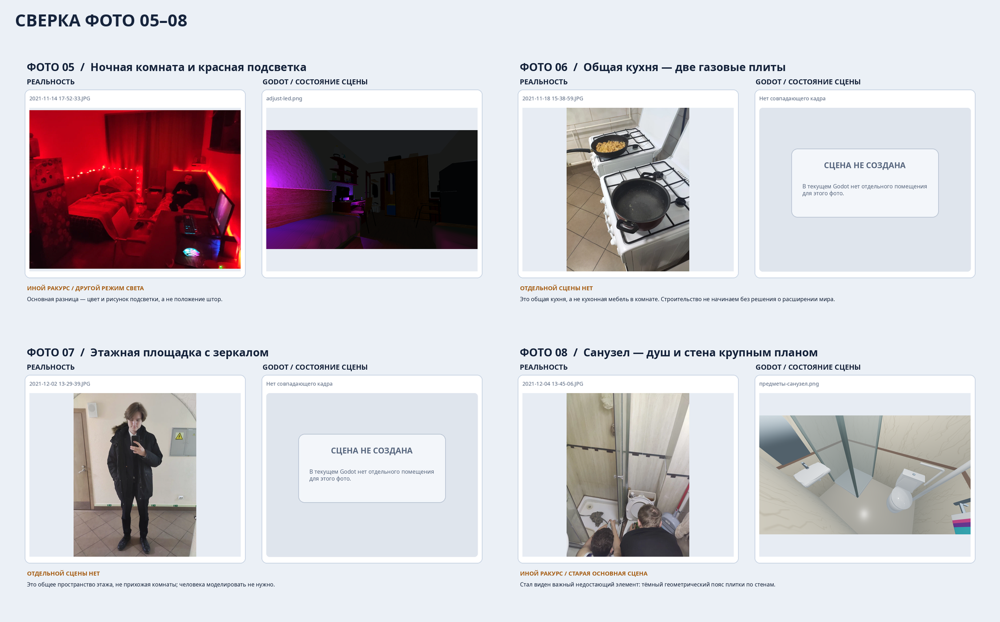
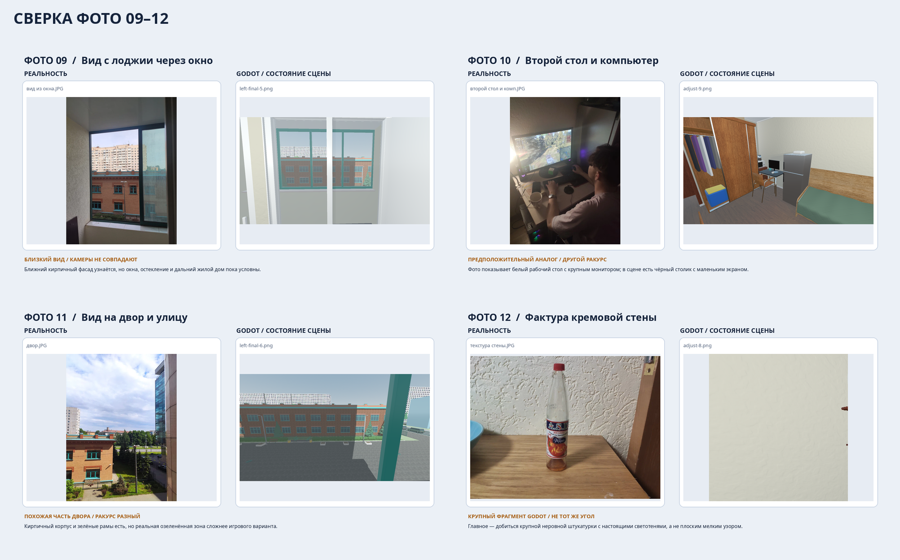

# Общага — сводка сверки всех 12 фото

**Дата:** 23.11.2026. **Архивы:** исходное `обшага.rar`, проект `Общага.rar`, дополнение `obshaga_complete_pack.zip`.

**Правило автора:** шторы закрыты на одном фото и раздвинуты в игре — это НЕ ошибка; урна у лавок отложена. Промежуточные архивы не отправлять.

**Результат:** 12/12 референсов просмотрены, сравнения с имеющимися кадрами созданы; совпавшие рендеры для каждого фото ещё требуют запуска Godot. 3D-правки этого пакетного этапа не выполнялись.

> **Важно:** эта сверка **неполная**. Здесь собраны рабочие сравнения по существующим или приблизительным игровым кадрам. Для финальной проверки нужно заново переснять сцены из Godot и ещё раз пройти все замечания. См. [../Фотосверка_2026-11-23.md](../Фотосверка_2026-11-23.md).

## Уже проверено ранее

| № | Фото | Комментарий | Сравнение |
|---|---|---|---|
| 01 | `туалет.JPG` | [Санузел и v2](Сверка_санузла_2026-11-23.md) | [кадр](../../Графика/Кадры/Фотосверка_2026-11-23/санузел-фото-и-godot.png) |
| 02 | `урна.JPG` | [ОТЛОЖЕНА по решению автора](Сверка_урны_2026-11-23.md) | [кадр](../../Графика/Кадры/Фотосверка_2026-11-23/урна-фото-и-godot.png) |
| 03 | `коридор.JPG` | [Этажный коридор не построен](Сверка_коридора_этажа_2026-11-23.md) | [кадр](../../Графика/Кадры/Фотосверка_2026-11-23/коридор-этажа-фото-и-godot.png) |
| 04 | `комната.JPG` | [Исправлено: шторы НЕ ошибка](Сверка_комнаты_2026-11-23.md) | [кадр](../../Графика/Кадры/Фотосверка_2026-11-23/комната-фото-и-godot.png) |

## Оставшиеся фото 05–12

| № | Фото | Детальный список задач | Сравнение |
|---|---|---|---|
| 05 | `2021-11-14 17-52-33.JPG` | [Заметки](Сверка_05_ночная-комната_2026-11-23.md) | [Картинка](../../Графика/Кадры/Фотосверка_2026-11-23/05-ночная-комната-фото-и-godot.png) |
| 06 | `2021-11-18 15-38-59.JPG` | [Заметки](Сверка_06_общая-кухня_2026-11-23.md) | [Картинка](../../Графика/Кадры/Фотосверка_2026-11-23/06-общая-кухня-фото-и-godot.png) |
| 07 | `2021-12-02 13-29-39.JPG` | [Заметки](Сверка_07_этажная-площадка-зеркало_2026-11-23.md) | [Картинка](../../Графика/Кадры/Фотосверка_2026-11-23/07-этажная-площадка-зеркало-фото-и-godot.png) |
| 08 | `2021-12-04 13-45-06.JPG` | [Заметки](Сверка_08_душ-санузел_2026-11-23.md) | [Картинка](../../Графика/Кадры/Фотосверка_2026-11-23/08-душ-санузел-фото-и-godot.png) |
| 09 | `вид из окна.JPG` | [Заметки](Сверка_09_вид-из-окна_2026-11-23.md) | [Картинка](../../Графика/Кадры/Фотосверка_2026-11-23/09-вид-из-окна-фото-и-godot.png) |
| 10 | `второй стол и комп.JPG` | [Заметки](Сверка_10_второй-стол-компьютер_2026-11-23.md) | [Картинка](../../Графика/Кадры/Фотосверка_2026-11-23/10-второй-стол-компьютер-фото-и-godot.png) |
| 11 | `двор.JPG` | [Заметки](Сверка_11_двор-и-улица_2026-11-23.md) | [Картинка](../../Графика/Кадры/Фотосверка_2026-11-23/11-двор-и-улица-фото-и-godot.png) |
| 12 | `текстура стены.JPG` | [Заметки](Сверка_12_текстура-стены_2026-11-23.md) | [Картинка](../../Графика/Кадры/Фотосверка_2026-11-23/12-текстура-стены-фото-и-godot.png) |

## Обзоры

**Ограничение:** архив `shots/` включает исходные частные кадры с людьми; не публиковать его без согласия автора. Отсутствующие локации не следует подменять изображением другой комнаты. Внешность людей не анализировалась.
