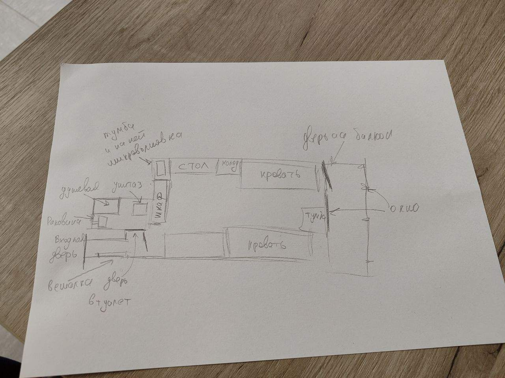
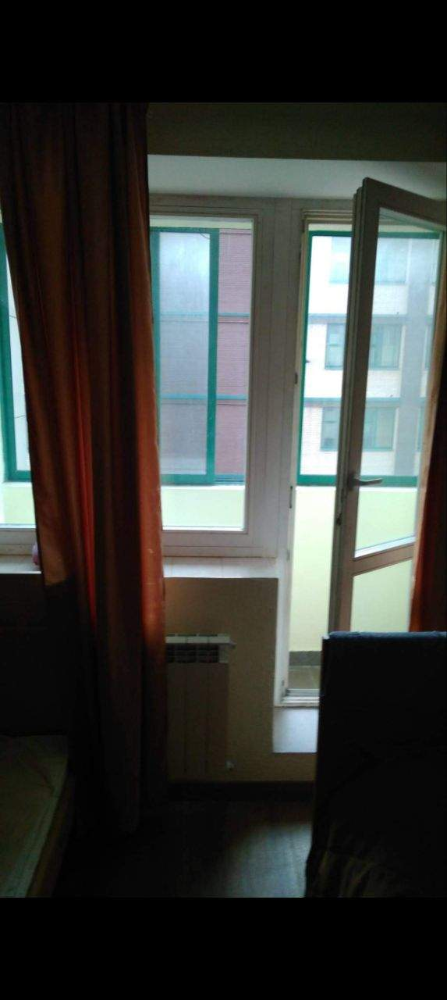
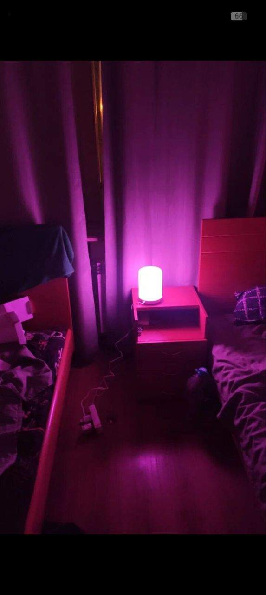

# Фото для продолжения работы

Сохранены 15.11.2026 из папки Drive автора. Просмотрено 11 файлов: четыре кадра без людей включены сюда; семь файлов с людьми (включая один дубликат) оставлены на Drive. Это доступная подборка из Drive, а не подтверждённый полный архив вложений чата.

- [Карта кадров](Карта_кадров.md) и [индекс](Кадры.json) помогают найти нужное место в исходных видео.
- [Разбор десяти видео](Видео_разбор.md) и [разбор фото 14.11](Референсы_14-11.md) содержат наблюдения и уточнения автора.
- [Двор и панорамы от 23.11](Двор_2026-11-23/README.md) содержат схему и отметки автора.

## Авторская схема

Главный источник стороны балконной двери и порядка мебели. Размеры на рисунке не заданы.

Источник: `IMG_20261115_072559_751.jpg`.

## Лоджия

Зелёные рамы, светлая стенка, тёмная плитка, подоконник и фасад напротив.

Источник: `IMG_20261115_072559_443.jpg`.

## Балконная дверь — другая комната

Оранжевые шторы и дверь справа: пример конструкции и открывания внутрь. НЕ переносить сторону двери или планировку в авторскую комнату.

Источник: `IMG_20261115_072600_184.jpg`.

## Ночник между кроватями

Расположение тумбы и цилиндрического светильника, характер ночного света. Цвет штор и покрывал при таком освещении не определять.

Источник: `IMG_20261115_072559_656.jpg`.

Оригиналы и оставшиеся кадры: [папка Drive](https://drive.google.com/drive/folders/1R7kuWVsG1TpuBPkm6Ern_i9B48c5G8y0). Фотографии с людьми не публиковать без отдельного согласия. Технические данные сжатия записаны в `манифест.json`.

## Двор и Наличная улица

[Карта и 13 панорам от 23.11.2026](Двор_2026-11-23/README.md).

## Стол, мышь и системный блок

- [Коврик и мышь на столе](06-коврик-и-мышь.png) — основной референс размера коврика, расположения рядом с клавиатурой и проводной мыши с цветной подсветкой. Пакет и продукты в сцену не переносим.
- [Чистый рисунок коврика](05-коврик.png) — вспомогательный кадр зелёного логотипа и фактуры для текстуры.
- [Видео сборки ПК](https://disk.yandex.ru/d/NDbEIUebnmHyZg) — `VID_20221031_220750.mp4` (превью показывает чёрный корпус и стеклянную боковину), `VID_20221101_014526.mp4` (превью показывает подсветку корпусных вентиляторов и памяти). Исходные ролики остаются по ссылке.
- [Xiaomi Mi Bedside Lamp 2](https://www.mi.com/global/product/mi-bedside-lamp-2/) — белый рассеиватель со скруглённым верхом, низкое основание и сенсорная полоса спереди.
