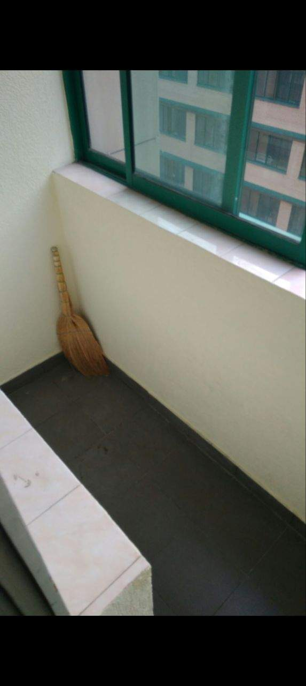

# Фото для продолжения работы

Сохранены 15.11.2026 из папки Drive автора. Просмотрено 11 файлов: четыре кадра без людей включены сюда; семь файлов с людьми (включая один дубликат) оставлены на Drive. Это доступная подборка из Drive, а не подтверждённый полный архив вложений чата.

Другому чату: открой изображения через просмотр файлов, затем прочитай `../Референсы_14-11.md` и `../ПРОДОЛЖИТЬ.md`. Одного текстового описания недостаточно для визуальной сверки.

## Авторская схема

Главный источник стороны балконной двери и порядка мебели. Размеры на рисунке не заданы.

Источник: `IMG_20261115_072559_751.jpg`.

## Лоджия

Зелёные рамы, светлая стенка, тёмная плитка, подоконник и фасад напротив.

Источник: `IMG_20261115_072559_443.jpg`.

## Балконная дверь — другая комната

Оранжевые шторы и дверь справа: пример конструкции и открывания внутрь. НЕ переносить сторону двери или планировку в авторскую комнату.

Источник: `IMG_20261115_072600_184.jpg`.

## Ночник между кроватями

Расположение тумбы и цилиндрического светильника, характер ночного света. Цвет штор и покрывал при таком освещении не определять.

Источник: `IMG_20261115_072559_656.jpg`.

Оригиналы и оставшиеся кадры: [папка Drive](https://drive.google.com/drive/folders/1R7kuWVsG1TpuBPkm6Ern_i9B48c5G8y0). Фотографии с людьми не публиковать без отдельного согласия. Технические данные сжатия записаны в `манифест.json`.
