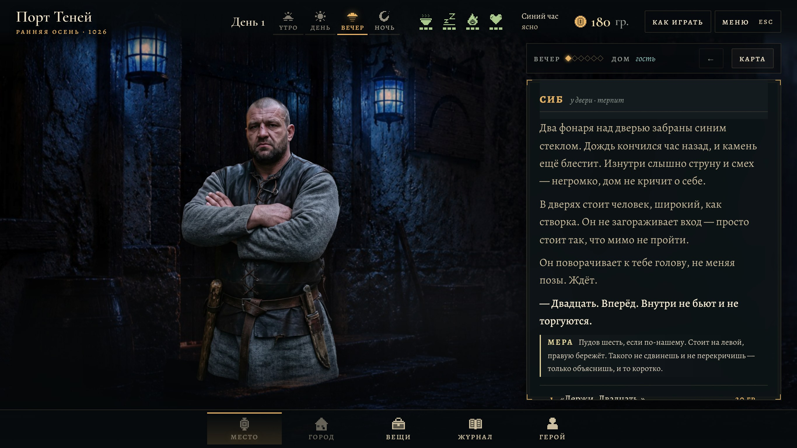
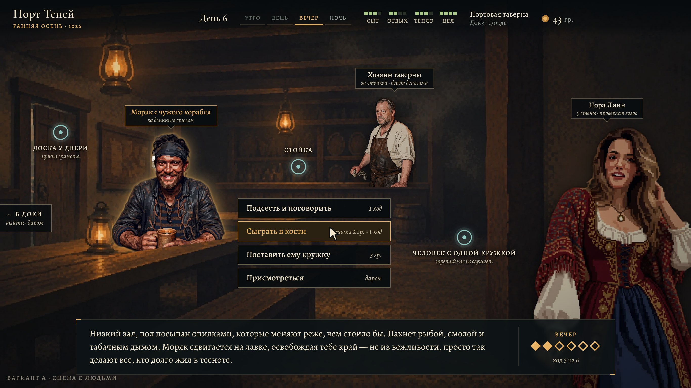
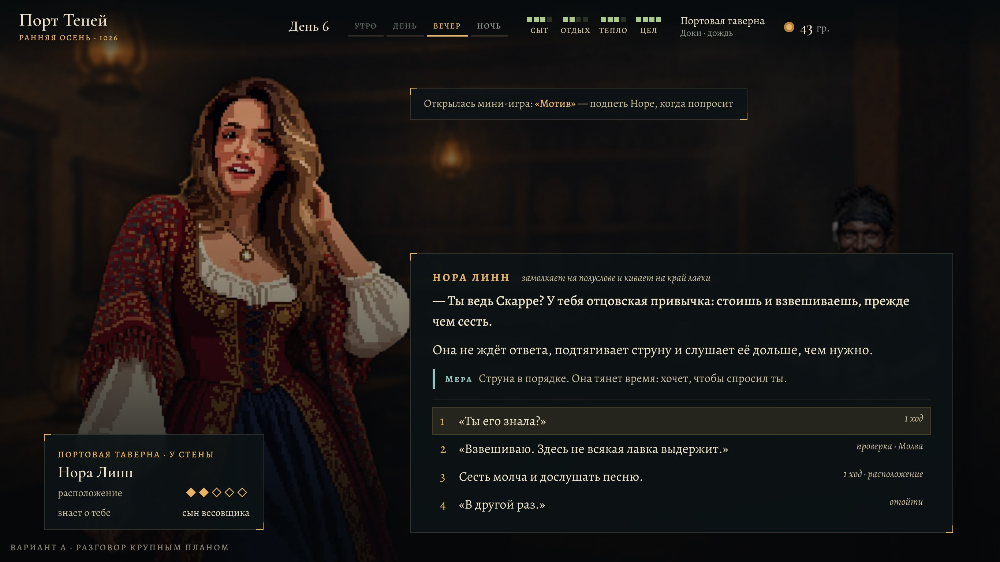
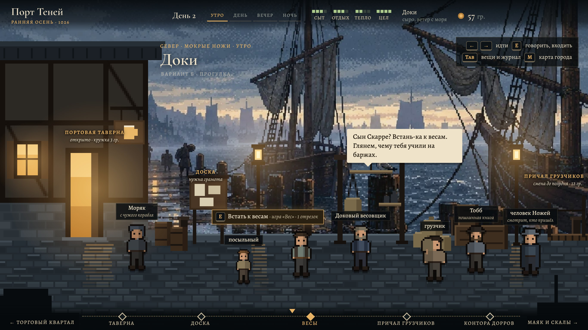
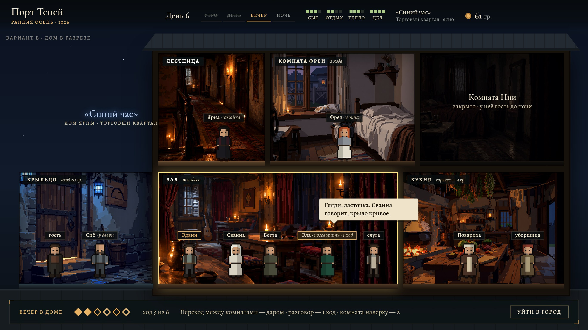
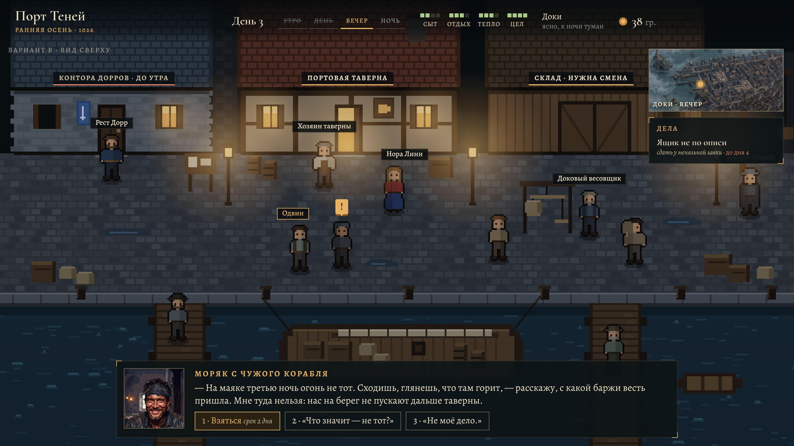
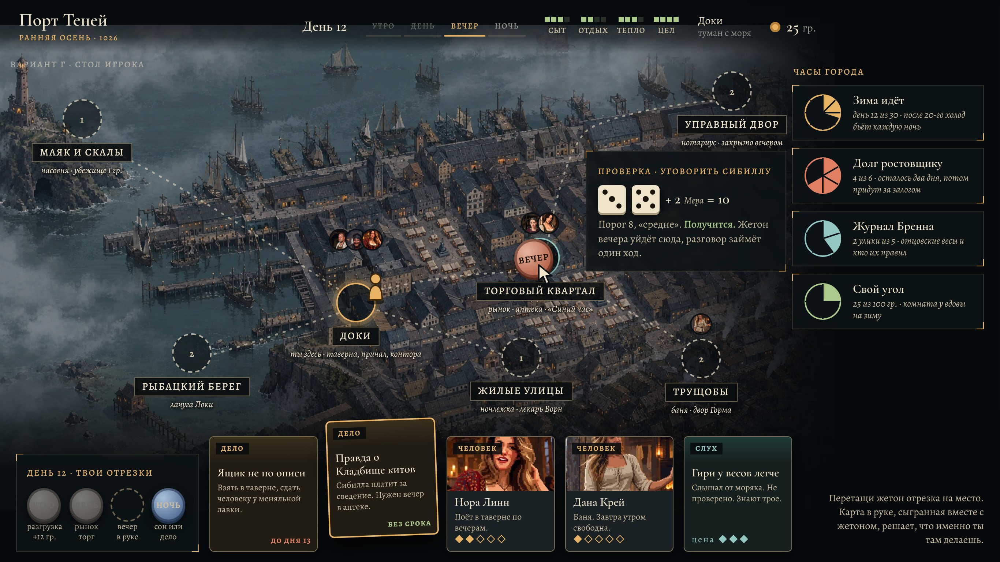

# «Порт» как полноценная игра — четыре варианта вида

Концепт от 11.11.2026 по просьбе автора: как перевести игру из текстовой в игру, где город и люди на экране.
**Статус: ждёт выбора автора (доска, Р18).** В игре ничего не менялось.

Страница с разбором и снимками: https://claude.ai/artifact/4Z72uWAfdfqi9JkvzrbwkX

Все варианты меняют только вид и управление. Правила, тексты, сохранения и разговор (текст с выбором реплик) остаются.

| Вариант | Суть | Что рисовать | Что программировать | Объём |
|---|---|---|---|---|
| **А. Сцена с людьми** | место — картина, жители стоят в ней фигурами, предметы светятся точками; разговор крупным планом | фигуры жителей без фона | экран места и разговора; координаты людей и деталей на картинах комнат | малый |
| **Б. Прогулка и дом в разрезе** | район — набережная, герой ходит влево-вправо; дом показан в разрезе со всеми комнатами | передний план районов, маленькие фигурки с походкой | ходьба, расстановка жителей по отрезкам суток | средний |
| **В. Вид сверху** | город из клеток, как в классических пиксельных RPG | почти всё заново: клетки районов и интерьеров, фигурки в четыре стороны | почти всё заново: столкновения, поиск пути, расписания | самый большой |
| **Г. Стол игрока** | карта города — доска, отрезки суток — жетоны, дела, люди и слухи — карты, проверка — два кубика, сроки — круглые часы | рамки карт, жетоны | экран города, показ броска | малый |

**Совет:** А и Г вместе (Г — город, А — место), затем проба Б на одном куске: набережная доков и «Синий час» в разрезе. В не советую: готовый арт (около ста картин) в него не попадает, а лица и близость в нём мельче всего. До начала А стоит закрыть Р9 о виде портретов.

## Снимки

| | |
|---|---|
| Как сейчас |  |
| А — сцена |  |
| А — разговор |  |
| Б — прогулка |  |
| Б — дом в разрезе |  |
| В — вид сверху |  |
| Г — стол |  |

## Что здесь лежит

- `А1-сцена.html` … `Г-стол.html` — макеты, неподвижные страницы 1366×768. Открывать через сервер из папки `Игры/Порт/` (берут картинки из `Ресурсы/`).
- `общее.css`, `общее.js` — цвета игры, шапка, пиксельные человечки, нарисованные кодом.
- `Фигуры/` — 13 фигур, вырезанных автоматически (rembg, u2net) из готовых портретов, и шесть лиц для карт. Только для макетов.
- `Снимки/` — готовые снимки макетов и нынешнего экрана.

## Что в макетах настоящее, а что нет

- Из данных игры: таверна (люди, детали, цены), дела, часы работы мест, правило проверки 2d6 + голос против порога.
- Придумано для примера: реплики Норы, весовщика и моряка, подписи на картах и часах.
- Заглушки: человечки в Б и В, передний план набережной и весь вид сверху нарисованы кодом, чтобы показать масштаб.
